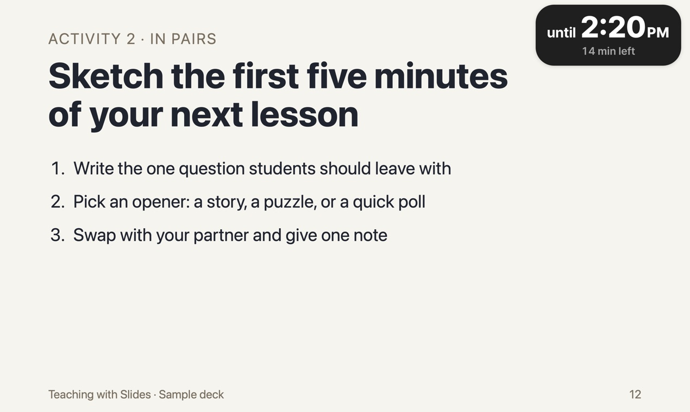
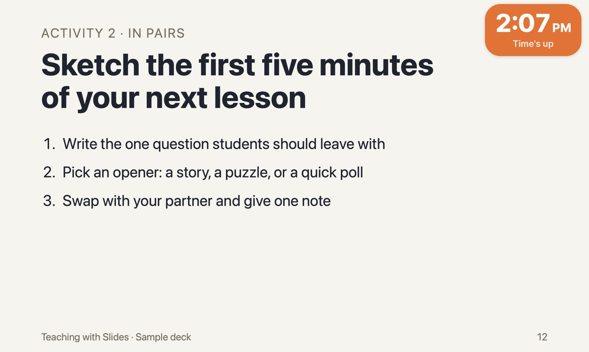
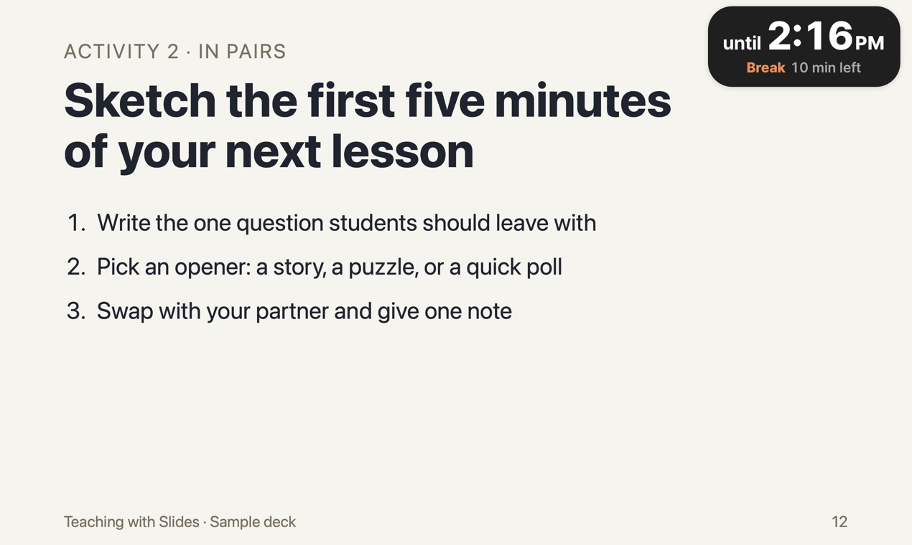
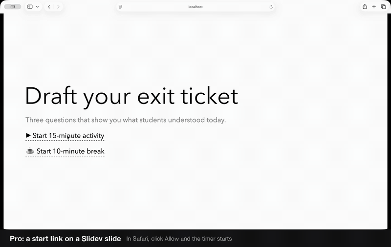
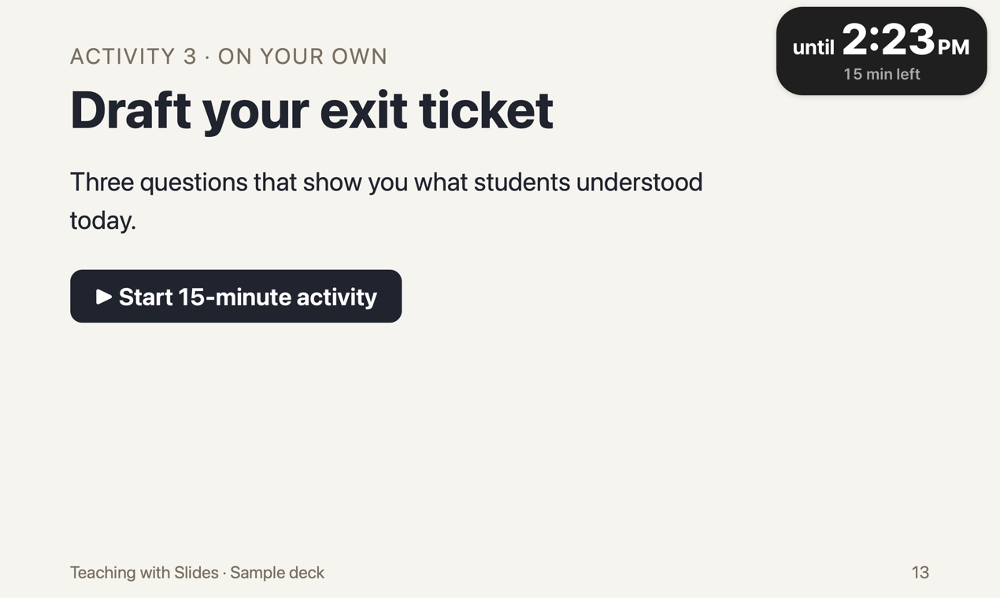

# Fadeclock

A Mac timer for people who teach or present with slides. It floats in a corner above your full-screen slides and shows **when the activity ends**, not just minutes ticking down.



*The real app, captured on a Mac over a full-screen sample slide (a web page in Safari).*

**Download and details: [fadeclock.app](https://fadeclock.app)** (free, macOS 13 or later)

This repository holds the app's public page on GitHub, examples for the slide start links, and the issue tracker. The app itself is closed source.

## What it does

- **The end time, in big type.** The capsule reads `until 2:30 PM` with the minutes left underneath. One look tells the room when to stop.
- **Music that fades out before time's up.** Paste a YouTube link once. When an activity starts, the music rises from silence over 20 seconds. In the last 30 seconds it fades out, and one chime marks the end.
- **Stays out of your way.** It floats above full-screen slides, and clicks outside the capsule go straight to your slides. You can shrink it to a small dot that keeps counting down.
- **Breaks.** A break gets its own label, and the capsule says "Break's over" when it ends.
- **Shortcuts from any app.** `⌃⌥5` starts five minutes or adds five more. `⌃⌥1` and `⌃⌥0` do the same for one and ten minutes. No Accessibility permission needed.
- **Shows on the projector.** It appears on your external display when one is connected, in four sizes.

| Time's up | Break |
|---|---|
|  |  |

## Before you download

- Fadeclock is **not notarized by Apple** yet. macOS blocks it the first time you open it, and you need to allow it in System Settings → Privacy & Security → Open Anyway. The steps are on [fadeclock.app](https://fadeclock.app). On a Mac managed by a school or a company, that option may be turned off.
- It has been tested in **Keynote** presentation mode and in a **PowerPoint** slideshow: the timer stays on top of the slides. Google Slides has not been tested yet.
- It is built for Apple silicon and Intel Macs, but it has not been run on an Intel Mac yet.
- No account, no analytics in the app. YouTube music connects to YouTube, and YouTube may play ads.

## Price

The download is free: the timer, the end time, breaks and YouTube music all work without paying.

**Fadeclock Pro** is $12, paid once. It lets you play music from a folder on your Mac and add start buttons to your slides (see below). Full refund within 14 days. Payments are handled by Paddle.

**Black Friday 2026:** Fadeclock Pro is $6 instead of $12 (50% off) with the code `BF2026`, through November 30, 2026 (Pacific time). Click Buy Pro on [fadeclock.app](https://fadeclock.app/#price), choose Add discount at checkout, and enter the code.

## Start a timer from a slide (Pro)

A link on a slide can start the timer.

**Keynote and PowerPoint.** Put a link such as `fadeclock://start?min=15` on a shape in a slide. Clicking the shape during the slideshow starts a 15-minute timer. This has been tested with Keynote 14 and PowerPoint 16 on a Mac, with the link on a shape (a link on text has not been tested). Keynote hides the slideshow for a second or two while the timer starts. PowerPoint shows a security notice first, and you click through it.

**HTML slides.** If your slides are HTML (reveal.js, Slidev, Marp, or a plain web page), a normal link can start the timer:

```html
<a href="fadeclock://start?min=15">▶ Start 15-minute activity</a>
```

Clicking it starts a 15-minute timer. Safari asks before it opens Fadeclock, and you click Allow.



| Link | What it does |
|---|---|
| `fadeclock://start?min=15` | Start a 15-minute timer. `min` can be 1 to 180. |
| `fadeclock://start?min=10&label=Break` | Start a 10-minute timer labeled Break. |
| `fadeclock://adjust?min=5` | Add five minutes to the running timer. Use `-5` to take five away. |
| `fadeclock://finish` | End the timer. |

Copy-and-paste examples are in [`examples/`](examples/):

- [`plain.html`](examples/plain.html): a single slide as a plain web page.
- [`reveal.html`](examples/reveal.html): a reveal.js slide.
- [`slidev.md`](examples/slidev.md): a Slidev slide.
- [`marp.md`](examples/marp.md): a Marp slide.

All four have been tested in Safari 26 on macOS (reveal.js 6.0, Slidev 53, and HTML exported by Marp CLI 4.5). Other browsers have not been tested. If one does not work for you, please [open an issue](../../issues) with the tool and browser you use.

Copy and change these examples however you like.



## Questions, ideas, bugs

[Open an issue](../../issues) here, or email support@fadeclock.app.

## Who makes it

Dogwang Seong teaches hands-on AI workshops for companies and universities in Korea, designed this timer for those workshops, and uses it when teaching.
